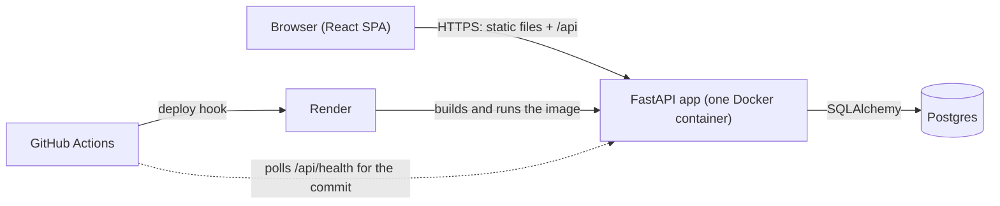

# PersonalDolar

A single-user personal finance web app: track income, expenses and investments by hand, see where your money goes, and simulate how your savings could grow.

**Live demo: <https://personaldolar.onrender.com>** (free Render instance: after 15 minutes idle the first request has a cold start of about 1 minute).

- [PersonalDolar](#personaldolar)
  - [Problem](#problem)
  - [Features and expected behaviour](#features-and-expected-behaviour)
  - [Architecture](#architecture)
  - [Run locally](#run-locally)
  - [Tests](#tests)
  - [CI/CD and deployment](#cicd-and-deployment)
  - [How it was built with AI agents](#how-it-was-built-with-ai-agents)
  - [Security](#security)
  - [Evaluation criteria map](#evaluation-criteria-map)

## Problem

Most people do not know where their money goes each month, how their investments are really performing, or whether their savings plan will reach a goal (a house deposit, early retirement) in time. Spreadsheets work but are tedious and give no forward-looking view, and the alternatives need a bank connection or a paid subscription.

PersonalDolar is for anyone who wants to organise their finances and plan ahead **without connecting a bank or paying for anything**: everything is entered manually, there are no market-data APIs and no paid services. Language is English and the currency is USD. Full product spec: [`docs/plan.md`](docs/plan.md) §1–§3.

Why I built it: I wanted one place where I could see my real monthly cash flow and what my savings could become, without handing my bank credentials to a third party. It also served as a realistic project to learn how to build a whole product with a team of AI agents.

## Features and expected behaviour

| Feature | Expected behaviour |
| --- | --- |
| Public landing | Guests see a landing page at `/` with links to log in or create an account; a logged-in user sees the dashboard at `/`. Every other page requires a session (guests go to `/login`). Logging out returns to `/`. |
| Register and login | Email + password. Passwords are hashed with Argon2; the session is a JWT in an httpOnly cookie. Each user only ever sees their own data (another user's resource answers 404). |
| Categories and subcategories | Two levels (e.g. Transport → Fuel). Every new user gets a default set of expense and income categories and can add, rename and delete their own. A category with transactions or monthly amounts cannot be deleted until they are reassigned or removed. A **fixed monthly amount** (net, optional note) can be set on a subcategory, or on a category without subcategories (e.g. Rent, Salary); it models a typical month, applies to every month, and is not a transaction. |
| Transactions | Manual, one-off income and expenses with date, positive amount, category, subcategory and optional note; create, edit, delete, list, filter by period and category. An income can store **gross and net** salary (net cannot exceed gross) and the form shows the deduction rate `(gross − net) / gross`; totals and simulations use the net amount. |
| Investments | Name, type (Stock, Fund, ETF, Crypto, Deposit, Real estate, Other), platform, amount invested and current value, updated by hand (no live prices). Gain/loss in $ and % per investment and for the whole portfolio. |
| Dashboard | Period selector: current month (default), current year or a custom range. For the period: income, expenses, savings and savings rate. Pie chart of expenses by category (click a category to see its subcategories, with a Back button). Investments: total invested, current value, gain/loss and a pie chart by type. Monthly amounts count once per month in the period. |
| Simulator | Three modes: **A Accumulation** (projected value year by year), **B Goal** (periodic contribution needed to reach a target amount by a date), **C Withdrawal** (accumulate until an age, then withdraw a % per year or a fixed monthly amount; shows whether the money lasts). Each mode runs three return scenarios (pessimistic, base, optimistic) as separate chart lines, with an inflation rate (default 2%) to show today's dollars. Results are deterministic (pure Python module with unit tests) and the page always shows "Projections are estimates, not financial advice." |
| Account deletion | `/account` has a danger zone: deleting the account and all its data asks for the password (`DELETE /api/auth/me`); a wrong password deletes nothing. |
| Login rate limit | Per client IP, in memory: 10 login and 5 register attempts per 60 s (the delete-account endpoint shares the login counter). Over the limit the API answers 429 with a `Retry-After` header, even for a correct password. |

**Non-goals** (from [`docs/plan.md`](docs/plan.md) §6): bank connections or importing statements; live market prices or any external financial API; tax calculation from gross salary; multi-currency; shared or family accounts; financial advice or recommendations; password recovery/reset by email (it needs an external email service; deleting your own account is supported).

## Architecture



The same container serves the built SPA and the `/api` routes, so there is one origin and no CORS. Full design: [`docs/tech-spec.md`](docs/tech-spec.md).

| Layer | Technology | Why |
| --- | --- | --- |
| Frontend | React 19, Vite, TypeScript (strict), React Router, TanStack Query, Tailwind CSS 4, Recharts, React Hook Form + Zod | Typed SPA with server-state caching and the pie/line charts the dashboard and simulator need |
| Backend | FastAPI, Pydantic v2, Python 3.12 | Typed API with OpenAPI generated for free; the frontend types are generated from it |
| Database | SQLAlchemy 2.0 + Alembic; SQLite in development, Postgres 17 in production | Same models in both, versioned migrations; `NUMERIC` and `Decimal` for money, never `float` |
| Auth | Argon2 password hashing, JWT in an httpOnly cookie | The token is not readable from JavaScript |
| Simulator | Pure Python module in the backend | Deterministic, no I/O, unit-tested with known values |
| Container | Multi-stage `Dockerfile`, `docker-compose.yml` for local runs | One image to build, test and ship |
| Hosting | Render (free web service + free Postgres), `render.yaml` | Free, deploys from the Docker image |
| CI/CD | GitHub Actions | Tests, static analysis and deploy on one pipeline |

## Run locally

Requirements: Docker, or Python 3.12 + [uv](https://docs.astral.sh/uv/) and Node.js 24+ for the dev servers.

**Single command (app + Postgres 17, production-like image):**

```bash
docker compose up --build        # then open http://localhost:8000
APP_PORT=8010 docker compose up --build   # another host port
docker compose down -v           # stop and delete the database volume
```

Compose is for local use only (plain http, throwaway credentials, port bound to `127.0.0.1`); details in [`docs/deployment.md`](docs/deployment.md#local-production-like-run-docker-compose).

**Dev servers (hot reload, SQLite):**

```bash
# Backend: http://localhost:8000 (API docs at /api/docs)
cd backend
cp .env.example .env
uv sync
uv run alembic upgrade head
uv run fastapi dev app/main.py

# Frontend: http://localhost:5173 (proxies /api to the backend)
cd frontend
npm install
npm run dev
```

`openapi.json` at the repo root is the API contract; after changing a backend route or schema, regenerate it and the frontend types (commands in [`docs/backend.md`](docs/backend.md), CI fails if either is stale). Per-side conventions: [`docs/backend.md`](docs/backend.md), [`docs/frontend.md`](docs/frontend.md).

## Tests

Run everything with one command:

```bash
./scripts/test.sh     # or: make test
```

Strategy, what each suite covers and the per-side commands: [`docs/testing.md`](docs/testing.md).

## CI/CD and deployment

Flow: pull request → CI runs the backend, frontend, Postgres, Docker image, no-secrets and Semgrep jobs → merge to `main` → the `deploy` job calls the Render deploy hook → it polls `/api/health` until the service reports the pushed commit SHA, so green means that commit is live. Setup, environment variables, rollback, free-tier limits and the smoke test: [`docs/deployment.md`](docs/deployment.md). Pipeline: [`.github/workflows/ci.yml`](.github/workflows/ci.yml).

## How it was built with AI agents

The project was built by a small team of Claude Code agents coordinated by a main session (the orchestrator), following [`docs/process.md`](docs/process.md):

- **Agent team:** a project manager (breaks a milestone into groomed issues), a software engineer (implements one issue) and a QA engineer (verifies it against the acceptance criteria and never changes code). Role definitions: [`.claude/agents/`](.claude/agents/) and [`docs/team/`](docs/team/).
- **Context management:** [`AGENTS.md`](AGENTS.md) holds the non-negotiable rules and links to modular docs (specs, backend, frontend, security, process) that agents read only when a task needs them.
- **Slash commands:** `/plan-milestone`, `/next-issue`, `/run-milestone` and `/close-milestone` in [`.claude/commands/`](.claude/commands/) drive the loop.
- **Tracker:** GitHub issues with acceptance criteria; the engineer implements, QA verifies, and only the orchestrator closes an issue after a QA PASS. Delivery plan and status: [`docs/milestones.md`](docs/milestones.md).

## Security

Index of audits and policies: [`docs/security.md`](docs/security.md). Key points:

1. Passwords are hashed with Argon2; the JWT lives only in an httpOnly cookie, never in localStorage or response bodies.
2. Every query on user data is filtered by the current user; foreign keys in request bodies are checked, and other users' resources answer 404.
3. Secrets come only from environment variables; the `no-secrets` CI job fails on tracked `.env`, database or key files, and production refuses to start with a weak `JWT_SECRET` or an insecure cookie.
4. Login, register and account deletion are rate limited per client IP, and CI runs Semgrep static analysis on every push.

## Evaluation criteria map

Where to find each criterion of the course rubric:

| Criterion | Where | Status |
| --- | --- | --- |
| Problem Description | This README: [Problem](#problem), [Features](#features-and-expected-behaviour) | Done |
| Product Specification | [`docs/plan.md`](docs/plan.md) (user stories, acceptance criteria, non-goals) | Done |
| Agent Team Specification | [`docs/team/`](docs/team/), [`.claude/agents/`](.claude/agents/), [`docs/process.md`](docs/process.md) | Done |
| Context Management | [`AGENTS.md`](AGENTS.md) and the modular docs in [`docs/`](docs/) | Done |
| Application | [`backend/`](backend/), [`frontend/`](frontend/), live at <https://personaldolar.onrender.com> | Done |
| Testing | [Tests](#tests), [`docs/testing.md`](docs/testing.md), `backend/tests/`, `frontend/src/**/*.test.tsx` | Done |
| Containerization | [`Dockerfile`](Dockerfile), [`docker-compose.yml`](docker-compose.yml) | Done |
| Deployment | [`docs/deployment.md`](docs/deployment.md), [`render.yaml`](render.yaml) | Done |
| CI/CD | [`.github/workflows/ci.yml`](.github/workflows/ci.yml), [CI/CD and deployment](#cicd-and-deployment) | Done |
| Observability | Not yet documented in the repo | **In progress** |
| Alerting on User Impact | Not yet documented in the repo | **In progress** |
| On-Call Agent | Not yet documented in the repo | **In progress** |
